# 🦊 DesertFox — Complete Project Handoff & Architecture Document

**Date:** 2026-10-24  
**Repository:** [https://github.com/itthj/desertfox.git](https://github.com/itthj/desertfox.git)  
**Local Workspace:** `/home/kali/.gemini/antigravity/scratch/desertfox`  
**Current Branch:** `main` (clean, fully synced with `origin/main`)  
**Latest Commit:** `9d8f0ed` (`feat(accuracy): add 5-point landmark similarity transform alignment, head pose estimation, and multi-probe fusion`)  
**Test Suite Status:** 48/48 unit tests passing (100% green)

---

## 1. Executive Summary

**DesertFox** is an ethical, open-source facial recognition OSINT engine, reverse image search platform, and privacy exposure defense suite (an open alternative to PimEyes and FaceCheck.ID).

It allows users to audit their public biometric footprint, discover unauthorized likeness appearances across the open web, and automatically generate legally binding GDPR, CCPA, and DMCA erasure requests.

---

## 2. Core Architecture & Pipeline Components

```mermaid
graph TD
    UI["Cyber-OSINT HUD (index.html)"] --> API["FastAPI REST Server (server.py)"]
    CLI["CLI Command Suite (cli.py)"] --> Engine["DesertFoxEngine (engine.py)"]
    API --> Engine
    Celery["Celery & Celery Beat (tasks.py)"] --> Engine

    subgraph Biometrics & Vision
        Engine --> SCRFD["SCRFD 10GF Face Detector (onnx_detector.py)"]
        Engine --> Aligner["5-Point Umeyama Affine Aligner (alignment.py)"]
        Engine --> Embedder["ArcFace ResNet-50 Embedder (onnx_embedder.py)"]
        Engine --> Fusion["Multi-Probe Ensemble Fusion (probe_fusion.py)"]
        Engine --> FIQA["Face Quality Assessment (fiqa.py)"]
    end

    subgraph Indexing & Deduplication
        Engine --> FAISS["FAISS Index (faiss_index.py)"]
        Engine --> BKTree["BK-Tree Hamming Dedup (bktree.py)"]
        Engine --> PVI["Voronoi Partitioned ANN (advanced_index.py)"]
        Engine --> VS["Brute-Force VectorStore (vector_store.py)"]
    end

    subgraph Web Harvesting & OSINT
        Engine --> SearchAgg["SearchAggregator (Bing & DDG Scrapers)"]
        Engine --> Dorker["OSINT Platform Dorker (dorker.py)"]
        Engine --> SeedHub["SeedHubManager (Curated Bundles & Sitemaps)"]
        Engine --> SchedReg["SeedScheduleRegistry (seed_manager.py)"]
        Engine --> AsyncHarv["AsyncMediaHarvester (async_harvester.py)"]
        Engine --> Crawler["SiteCrawler (site_crawler.py)"]
    end

    subgraph Privacy & Remediation
        Engine --> ZKO["Zero-Knowledge Opt-Out (optout.py)"]
        Engine --> Enrollment["Searcher-Only Enrollment Lock (enrollment.py)"]
        API --> Takedown["GDPR / CCPA / DMCA Notice Generator (takedown.py)"]
    end
```



---

## 3. Implemented Modules Reference

| Module | File Location | Key Classes & Methods | Purpose |
|---|---|---|---|
| **5-Point Alignment & Pose** | [`desertfox/core/alignment.py`](file:///home/kali/.gemini/antigravity/scratch/desertfox/desertfox/core/alignment.py) | `FaceAligner.estimate_similarity_transform`, `align_face`, `estimate_head_pose` | Canonical ArcFace 112×112 Umeyama SVD procrustes alignment; 3D yaw/pitch/roll pose estimator. |
| **Multi-Probe Fusion** | [`desertfox/core/probe_fusion.py`](file:///home/kali/.gemini/antigravity/scratch/desertfox/desertfox/core/probe_fusion.py) | `MultiProbeFusion.process_probes`, `aggregate_match_scores` | Fuses 1-4 probe angles into quality-weighted composite embedding; computes pairwise consistency. |
| **ONNX Face Detector** | [`desertfox/core/onnx_detector.py`](file:///home/kali/.gemini/antigravity/scratch/desertfox/desertfox/core/onnx_detector.py) | `SCRFDDetector` | SCRFD 10GF model inference, NMS, 5-point landmark extraction. |
| **ONNX Face Embedder** | [`desertfox/core/onnx_embedder.py`](file:///home/kali/.gemini/antigravity/scratch/desertfox/desertfox/core/onnx_embedder.py) | `ArcFaceEmbedder` | ArcFace ResNet-50 512-d normalized feature representation. |
| **Model Weights Downloader** | [`desertfox/models/download.py`](file:///home/kali/.gemini/antigravity/scratch/desertfox/desertfox/models/download.py) | `download_models` | Automated download of SCRFD & ArcFace ONNX weights from Hugging Face `immich-app/buffalo_l`. |
| **FAISS Vector Storage** | [`desertfox/storage/faiss_index.py`](file:///home/kali/.gemini/antigravity/scratch/desertfox/desertfox/storage/faiss_index.py) | `FaissVectorIndex` | Supports `IndexFlatIP`, `IndexHNSWFlat`, `IndexIVFFlat` with `.records.json` metadata sync. |
| **Search Engine Scrapers** | [`desertfox/ingestion/search_aggregator.py`](file:///home/kali/.gemini/antigravity/scratch/desertfox/desertfox/ingestion/search_aggregator.py) | `SearchAggregator` | Concurrent 6-provider zero-API-key scrapers: **DuckDuckGo**, **Bing**, **Google**, **Brave**, **Yandex**, and **Wikimedia Commons** with pagination and round-robin interleaving. |
| **OSINT Platform Dorking** | [`desertfox/ingestion/dorker.py`](file:///home/kali/.gemini/antigravity/scratch/desertfox/desertfox/ingestion/dorker.py) | `OSINTDorker` | Generates 66 dorks across 8 categories: Social, Corporate, Academic, Speakers, News/Media, Developer/Tech, Public Records, and Visual Portfolios. |
| **Curated Seeds & Sitemaps** | [`desertfox/ingestion/seed_manager.py`](file:///home/kali/.gemini/antigravity/scratch/desertfox/desertfox/ingestion/seed_manager.py) | `SeedHubManager`, `SeedScheduleRegistry` | 134 curated seed directories across 8 bundles (Tech, Academic, Open Source, AI Labs, Venture, Infosec, Press, Policy), recursive XML/gzipped sitemap index extraction, and recurring scheduler. |
| **Distributed Queue & Beat** | [`desertfox/queue/celery_app.py`](file:///home/kali/.gemini/antigravity/scratch/desertfox/desertfox/queue/celery_app.py), [`tasks.py`](file:///home/kali/.gemini/antigravity/scratch/desertfox/desertfox/queue/tasks.py) | `run_scheduled_crawl_sweep`, `optimize_and_compact_index`, `bulk_crawl_urls_task` | Redis/Celery worker tasks and Celery Beat autonomous periodic crawlers. |
| **Pipeline Engine** | [`desertfox/pipeline/engine.py`](file:///home/kali/.gemini/antigravity/scratch/desertfox/desertfox/pipeline/engine.py) | `DesertFoxEngine` | Orchestrator tying vision, vector search, crawling, deduplication, and legal opt-outs. |
| **REST API Server** | [`desertfox/api/server.py`](file:///home/kali/.gemini/antigravity/scratch/desertfox/desertfox/api/server.py) | FastAPI app | REST endpoints for single/multi-probe search, dorking, bulk crawling, scheduler, and opt-outs. |
| **Cyber-OSINT HUD UI** | [`desertfox/templates/index.html`](file:///home/kali/.gemini/antigravity/scratch/desertfox/desertfox/templates/index.html) | Tactical Web Interface | Multi-angle probe drag & drop, web search scanner, dorking panel, bulk seed hub, scheduler controls. |
| **Legal Takedowns** | [`desertfox/privacy/takedown.py`](file:///home/kali/.gemini/antigravity/scratch/desertfox/desertfox/privacy/takedown.py) | `TakedownNoticeGenerator` | Formal GDPR Article 17, DMCA §512(c), and CCPA §1798.105 legal demand notices. |

---

## 4. Key Endpoints Reference

- `POST /api/search`: Single-image biometric audit against indexed faces.
- `POST /api/search/multi-probe`: Multi-photo ensemble search with 5-point alignment and pose estimation.
- `POST /api/search/harvest`: Immediate Bing & DuckDuckGo scraper and indexer.
- `POST /api/search/dork-harvest`: Multi-platform OSINT dorking harvest (social, corporate, academic, speakers).
- `GET /api/seeds/bundles`: List pre-configured seed bundles (tech execs, academic rosters, open-source).
- `POST /api/seeds/bulk-crawl`: Ingest and crawl bulk URLs or XML sitemaps.
- `GET /api/scheduler/schedules`: List active recurring crawl feeds.
- `POST /api/scheduler/register`: Register a new recurring crawl target with custom interval.
- `POST /api/scheduler/toggle/{id}`: Toggle schedule between active and paused.
- `POST /api/scheduler/trigger-now`: Manually trigger an immediate sweep pass.
- `POST /api/opt-out`: Register a likeness into the Zero-Knowledge Opt-Out table.
- `POST /api/takedown`: Generate GDPR / DMCA / CCPA notice.

---

## 5. Operations & Development Guide

### Running Unit Tests
```bash
cd /home/kali/.gemini/antigravity/scratch/desertfox
python3 -m unittest discover -s tests -v
```
*(All 48 tests pass in ~6 seconds.)*

### Starting the Live API & HUD Server
```bash
cd /home/kali/.gemini/antigravity/scratch/desertfox
python3 -m uvicorn desertfox.api.server:app --host 0.0.0.0 --port 8000
```
Open `http://localhost:8000` in the browser to access the Cyber-OSINT HUD.

### Starting Background Workers (Celery & Celery Beat)
```bash
# Terminal 1: Celery Worker
celery -A desertfox.queue.celery_app worker --loglevel=info

# Terminal 2: Celery Beat Periodic Scheduler
celery -A desertfox.queue.celery_app beat --loglevel=info
```

### Git Workflow Policy
Every incremental feature or fix must be tested and pushed directly to GitHub:
```bash
git add -A
git commit -m "feat/fix: <description>"
git push origin main
```
Remote credentials with PAT are configured on `origin/main`.

---

## 6. Recommended Next Steps for Future Sprints

1. **Search Provider Expansion**: Add zero-API-key scrapers for Google Images, Yandex, and Brave Search to broaden discovery reach.
2. **1-Click Remediation & Result Forensics**: Connect search match cards directly to the GDPR/DMCA notice generator with an interactive landmark alignment overlay.
3. **Containerized Production Deployment**: Finalize `docker-compose.yml` defining services for `api`, `redis`, `celery-worker`, and `celery-beat`.
