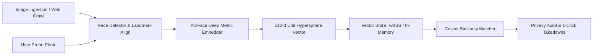

# 🦊 DesertFox: Open-Source Facial OSINT & Identity Exposure Engine

[](https://opensource.org/licenses/MIT)
[](https://python.org)
[]()
[]()

> **DesertFox** is an open-source reverse facial search, digital exposure auditing, and privacy remediation suite. It reconstructs the core architectural patterns of proprietary facial recognition search engines from first principles—combining state-of-the-art deep metric learning, vector indexing, an interactive Cyber-OSINT HUD, and automated privacy defense tools to help individuals monitor and protect their digital image footprint.

---

## 🎯 The Mission: From Surveillance to Defense

Commercial facial search engines (such as PimEyes, FaceCheck.id, and Clearview AI) crawl billions of images across the web. While technically powerful, they suffer from deep ethical and practical flaws:
1. **Paywalled Transparency:** Charging victims $30 to $300+/month just to view where their stolen or non-consensual images are published.
2. **Invasive Opt-Out Traps:** Forcing users to upload scans of government-issued passports or driver's licenses to request removal.
3. **Zero Legal Remediation:** Leaving individuals with no automated tools to demand removal under international privacy laws.

**DesertFox** solves these flaws by providing an open-source, self-hostable **defensive OSINT alternative**:
* **Identity Footprint Auditing:** Search portrait photos across indexed web corpora and public registries using 512-dimensional vector similarity.
* **Zero-Knowledge Opt-Out (ZKO):** Permanently blacklist your face likeness from search queries using salted, irreversible cryptographic hashes—**no identity documents required**.
* **1-Click Legal Remediation:** Instantly generate formally formatted **GDPR Article 17 (Right to Erasure)** and **DMCA Copyright Takedown** notices.

---

## 🏛️ Architecture & Platform Comparison



For an in-depth breakdown of how DesertFox compares against **PimEyes, Clearview AI, FaceCheck.id, and Google Lens**, read our [Competitive & Architectural Analysis](docs/COMPETITIVE_ANALYSIS.md). Mathematical derivations for ArcFace and vector indexing can be found in the [System Design Document](docs/SYSTEM_DESIGN.md).

---

## ⚡ Quickstart

### 1. Installation
Clone the repository and install dependencies:
```bash
git clone https://github.com/itthj/desertfox.git
cd desertfox
pip install -r requirements.txt
```

### 2. Launch the Cyber-OSINT HUD (Web Application)
Start the local server and open your browser:
```bash
python3 -m desertfox.cli serve --host 127.0.0.1 --port 8000
```
Then navigate to **`http://127.0.0.1:8000`** to access the full Cyber-OSINT Web UI with:
- Drag-and-drop face image scanner with animated reticle HUD
- Real-time similarity cutoff adjustments
- Live web page crawler & image extractor
- Zero-Knowledge Opt-Out registry console
- One-click GDPR/DMCA notice generator

---

### 3. Command-Line Interface (CLI)

#### Index demo biometric profiles:
```bash
python3 -m desertfox.cli index-demo --count 5 --store ./data/desertfox.index
```

#### Run a test reverse search query:
```bash
python3 -m desertfox.cli search-demo --store ./data/desertfox.index --threshold 0.60
```

#### Generate a formal GDPR Article 17, DMCA, or CCPA Erasure notice:
```bash
python3 -m desertfox.cli takedown \
    --url "https://unauthorized-site.example/leaked.jpg" \
    --name "Jane Doe" \
    --email "jane@example.com" \
    --type gdpr  # Choices: gdpr, dmca, ccpa
```

#### Download Production ONNX Models (SCRFD Face Detection & ArcFace Embeddings):
```bash
# List available models in the registry:
python3 -m desertfox.models.download --list

# Download both detector and embedder weights:
python3 -m desertfox.models.download --model all
```

---

### 4. Docker Deployment

Deploy DesertFox with a single command:
```bash
# Launch with Docker Compose
docker compose up -d

# Open Cyber-OSINT HUD: http://localhost:8000
```

To automatically pull pre-trained ONNX models on container startup:
```bash
docker compose --profile models up -d
```

---

## 🧪 Unit Tests
Run the test suite to verify embedding dimensions, perceptual hashing, vector search, and opt-out suppression:
```bash
python3 -m unittest discover -s tests
```

---

## 🛡️ Ethical OSINT Principles

DesertFox is built strictly as an educational and defensive security project:
- **Authorized Use Only:** Designed for self-auditing, authorized digital footprint investigations, and security research.
- **No Mass Surveillance:** Rate-limiting and Zero-Knowledge exclusion hashing prevent abuse as a stalkerware index.
- **Data Sovereignty:** 100% self-hosted with zero telemetry sent to third parties.

---

## 🗺️ Project Roadmap

- [x] Core architecture specification & metric learning design
- [x] Vector storage interface (Cosine Similarity & metadata indexing)
- [x] Automated GDPR / DMCA / CCPA takedown notice generator
- [x] Zero-Knowledge Opt-Out (ZKO) cryptographic registry
- [x] Web harvester with `dHash` perceptual deduplication & BK-Tree metric indexing
- [x] Interactive Cyber-OSINT HUD Web Application & REST API
- [x] Unit test suite
- [x] ONNX-runtime weights connector for SCRFD + ArcFace (Glint360k)
- [x] Dockerfile & Docker Compose multi-stage containerization
- [ ] Distributed Celery/Redis crawler task queue

---

## 📄 License
This project is licensed under the [MIT License](LICENSE).
