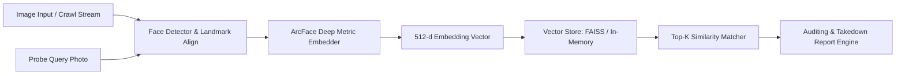

# 🦊 DesertFox: Open-Source Facial OSINT & Identity Exposure Engine

[](https://opensource.org/licenses/MIT)
[](https://python.org)
[]()

> **DesertFox** is an open-source reverse facial search and identity footprint auditing framework. It reconstructs the core architectural patterns of proprietary facial recognition search engines from first principles—combining state-of-the-art deep metric learning, vector search indexing, and automated privacy defense tools to help individuals monitor and protect their digital image footprint.

---

## 🎯 The Problem & Mission

Commercial facial search engines index billions of images scraped across the public internet. While they offer reverse image queries, they often operate behind expensive subscription paywalls, lack algorithmic transparency, and present significant privacy risks when used without consent.

**DesertFox** shifts the paradigm from surveillance to **defensive OSINT**:
1. **Footprint Auditing**: Empower users and security analysts to discover unauthorized, scraped, or leaked pictures across defined datasets and open web sources.
2. **Actionable Privacy Remediation**: Automatically generate legally grounded privacy notices (GDPR Article 17 Right to Erasure, CCPA, and DMCA takedowns) for exposed images.
3. **Privacy-Preserving Design**: Architecture designed with opt-out mechanisms and identity verification safeguards to prevent abuse as stalkerware.

---

## 🏛️ Architecture Overview

DesertFox decouples the facial search workflow into modular components:



Detailed technical breakdown, mathematical formulas, and benchmark comparisons are available in the [System Design Document](docs/SYSTEM_DESIGN.md).

---

## ⚡ Quickstart

### 1. Installation
Clone the repository and install core dependencies:
```bash
git clone https://github.com/itthj/desertfox.git
cd desertfox
pip install -r requirements.txt
```

### 2. Basic Usage (CLI)

#### Indexing an image or folder into the vector database:
```bash
python3 -m desertfox.cli index --source /path/to/crawled_images --store ./data/desertfox.index
```

#### Querying a probe photo to audit exposure:
```bash
python3 -m desertfox.cli search --probe /path/to/my_face.jpg --store ./data/desertfox.index --threshold 0.65
```

#### Generating a privacy takedown notice for found instances:
```bash
python3 -m desertfox.cli takedown --target-url "https://example.com/unauthorized_profile.jpg" --subject-name "Jane Doe" --jurisdiction GDPR
```

---

## 🛡️ Ethical & Legal OSINT Guidelines

DesertFox is built as an educational and defensive security project:
- **Authorized Use Only**: Designed for self-auditing, authorized digital footprint investigations, and legitimate OSINT research.
- **No Mass Surveillance**: The system emphasizes rate-limiting, consent checks, and exclusion registries.
- **Compliance**: Respects robots.txt, terms of service of indexed platforms, and international privacy laws.

---

## 🗺️ Project Roadmap

- [x] Core architecture specification & metric learning design
- [x] Vector storage interface (FAISS & In-Memory Cosine Similarity)
- [x] Automated GDPR / DMCA takedown notice generator
- [x] CLI for indexing and search auditing
- [ ] ONNX-runtime integration for RetinaFace + ArcFace models
- [ ] Distributed crawler module with perceptual hashing
- [ ] FastWeb REST API & Web Dashboard

---

## 📄 License
This project is licensed under the [MIT License](LICENSE).
